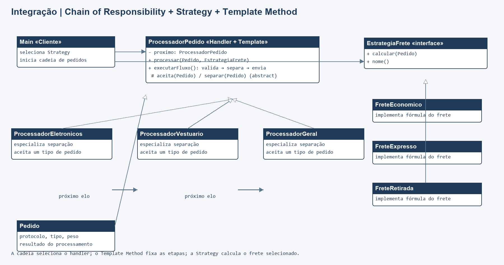

# Integração: Chain of Responsibility, Strategy e Template Method

Aplicação Java de processamento de pedidos. A cadeia encaminha cada pedido ao processador adequado (Chain of Responsibility), cada processador executa uma sequência fixa de etapas com pontos especializados (Template Method), e o cálculo do frete é escolhido por uma estratégia intercambiável (Strategy).

## Executar

JDK 8 ou superior, sem dependências externas:

```sh
mkdir out
javac -encoding UTF-8 -d out src/*.java tests/*.java
java -cp out Main
java -cp out IntegracaoTest
```

Se `out` já existir, pule `mkdir`.

## Como os padrões se integram

`Main` seleciona uma política de frete e envia o pedido para o primeiro `ProcessadorPedido`. A cadeia procura o processador que aceita o tipo do pedido. Esse processador executa o algoritmo fixo `executarFluxo`: valida, separa e calcula o envio. Cada subclasse personaliza a etapa de separação; a estratégia de frete pode variar sem alterar a cadeia ou o algoritmo.

## Participantes

| Padrão | Participantes |
| --- | --- |
| Chain of Responsibility | `ProcessadorPedido`, `ProcessadorEletronicos`, `ProcessadorVestuario`, `ProcessadorGeral` |
| Strategy | `EstrategiaFrete`, `FreteEconomico`, `FreteExpresso`, `FreteRetirada` |
| Template Method | `ProcessadorPedido.executarFluxo()` e passos de validação, separação e envio |

## Diagrama de classes



Fonte editável: [diagrama.mmd](docs/diagrama.mmd).

## Testes

`tests/IntegracaoTest.java` verifica encaminhamento por categoria, sequência do fluxo, fórmulas de frete, alternativas de estratégia e casos sem handler correspondente.
